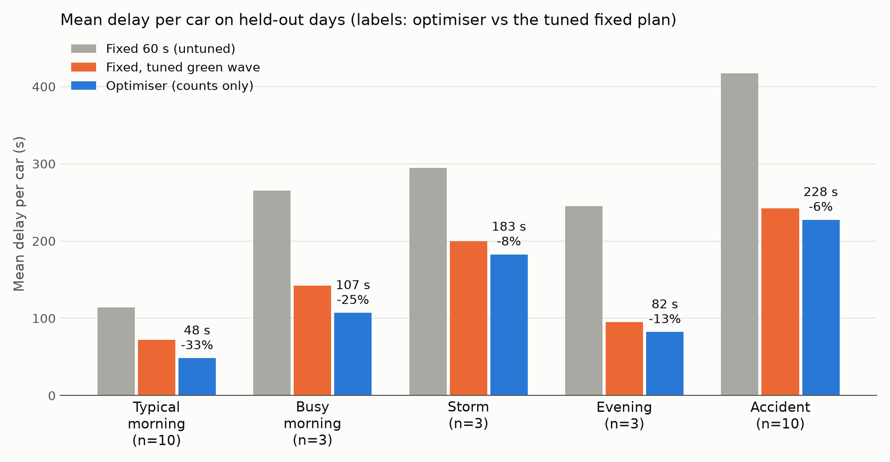
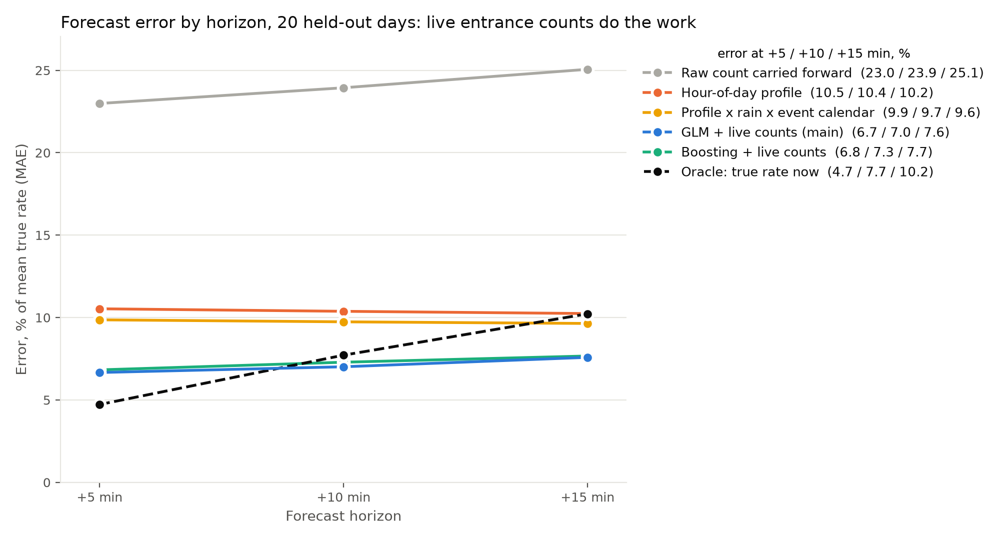

# Smart Traffic Signal Control (Quant Case Study, Problem 1)

Signal control for a 2x2 grid of junctions that can only see a car counter on each road into the network.
**Count -> forecast -> estimate the queues -> optimise -> measure wait time**, judged in a vehicle-level simulator
against fixed-time lights. Full detail (every assumption, table and ablation): [`docs/DETAILS.md`](docs/DETAILS.md).

## Results
Mean delay per car on held-out days the controller was never tuned on (`outputs/final_eval_counts/`):



| vs the tuned fixed plan | Typical AM | Busy AM | Storm | Evening | Accident | Stadium event |
|---|---|---|---|---|---|---|
| Delay saved | **32%** | **22%** | 15% | 14% | 7% | 5% |
| Seconds saved per car, 95% interval | 22.8 ± 4.0 | 31.4 ± 28.8 | 30.5 ± 11.2 | 13.8 ± 3.7 | 17.1 ± 18.3 | 6.3 ± 19.3 |
| Seeds | 10 | 3 | 3 | 10 | 10 | 10 |

- **vs the untuned 60 s fixed plan: 43-64% less delay in every scenario.** The brief's 20% target is met there everywhere, and against the tuned plan on the typical and busy mornings.
- The tuned baseline is deliberately strong: a green wave whose cycle was tuned on each scenario's normal day (120 s mornings, 180 s evenings).
- The accident and event savings are not significant. On one event day (seed 207) the optimiser does much worse than the tuned plan (217 vs 149 s).
- **The learned forecast is not what drives the gain.** The same optimiser fed persistence (repeat the last count), the learned forecast or a perfect forecast gives about the same delay (typical morning 49.2 / 49.4 / 49.1 s; event 135.4 / 132.3 / 128.8 s). It re-plans every minute from counts that already carry today's level. The gain comes from the queue model, the optimiser and gap-out (without gap-out the typical-morning saving falls from 30% to 12%, seeds 200-202).

## Approach
**Simulator** (`src/traffic/sim.py`). Every car follows the Intelligent Driver Model in 0.5 s steps on a 2x2 grid: one lane per approach, two signal phases, 200 m internal roads, 400 m entry roads, turns 70% straight / 15% left / 15% right. Queues, saturation flow (0.40 cars/s, 0.33 in rain) and spillback come out of the driving, not out of parameters. The controller plans with a much simpler model, so every result includes model error.

**Demand.** Poisson arrivals around a hidden rate: daily profile x today's level and timing shift x directional tide x rain x slow AR(1) noise x scheduled events. Six test scenarios: typical, busy (+15%) and stormy mornings, an accident (one lane blocked for 15 min at the peak), a typical evening, and an evening with a stadium crowd. All rates are assumptions, not fitted to a city.

**What the controller sees (counts only).** Entrance counters, the clock, a weather feed, an incident feed, an event calendar (announced crowd, not the real one) and its own signals. No cameras, no queue sensors; a test enforces this. Counters are what most cities have, and this makes control a prediction and estimation problem. An earlier camera version, which read the true queues, was no better (about 1 s better in the storm, worse in the other four scenarios tested).

**Forecaster** (`src/traffic/forecasting/`). Predicts arrivals at each entrance 5, 10 and 15 minutes ahead. A Poisson GLM: count data, and a log link makes the multiplicative demand effects additive. Inputs are clock harmonics, recent counts, weather and the calendar. A censoring guard ignores an entrance's counts when its road is full, because the counter then measures the jam, not the demand. Trained on 60 simulated days, split by whole days in time order (40 / 10 / 10, plus 10 fresh days).



The GLM's error is 7.1%, against 24.0% for the raw count carried forward and 10.4% for the hour-of-day profile. Gradient boosting is level overall (7.3%) but much worse on event windows (20.6% vs 13.3%, profile 40.4%), so the GLM was kept.

**Optimiser** (`src/traffic/controllers/optimiser.py`). A queue estimator steps a store-and-forward model every second from the counts and the controller's own signals. Every 60 s a convex quadratic program picks each junction's green split for the next 15 minutes, and the first minute is applied (receding horizon):

```
minimise  Σ queue + 0.3 Σ queue² + 3 · queue at horizon + 5 · spillback + 2 Σ |change in split|
s.t.      queue[k+1] = queue[k] + arrivals[k] − served[k],   served ≤ saturation flow × green,
          8-60 s greens, 4 s lost per switch, road storage (soft)
```
The quadratic term stops light approaches being starved. The cycle length comes from Webster's formula outside the program, because cycle × split would be non-convex. A solve takes 38 ms. Every second, gap-out ends a green early when the model says the approach is empty. When the incident feed reports an accident, the signals run the tuned fixed plan until an hour after it clears.

## Key decisions and trade-offs
- **Judged in a richer model than the one it plans with.** Scoring in the store-and-forward model would have hidden all model error.
- **Counts only.** This is harder and closer to what cities have. The cost is an unmeasured queue state, which turned out to be the main weakness.
- **GLM over boosting.** Same accuracy on normal days, better on rare events, and every coefficient is interpretable.
- **Convex QP over LP, mixed-integer or max-pressure.** A QP is globally optimal and fast. An LP tends to give all-or-nothing splits; there are no discrete choices that would need a mixed-integer program. Max-pressure has no look-ahead, and with true queues it lost to the optimiser in every scenario. Reinforcement learning would need far more data and is hard to explain.
- **Fair testing.** Common random numbers (same seed = same cars for every controller). Tuning seeds 100-109, evaluation 200-209, never mixed. Baselines and settings were tuned on normal days only. The event scenario was added after everything else was frozen.

## Known limitations
- **The queue estimate is never corrected from inside the network.** It drifts high in storms, and after an accident or in an event surge it assumes full roads keep draining; that is why the one event day goes wrong. A stop-line counter per road is the first thing to add.
- **The forecast adds little to control** at a 15-minute horizon, even in the event it predicts well.
- **Simplifications:** synthetic data (the forecaster recovers a process I wrote), no rerouting or pedestrians, two phases, offsets not optimised, 3 seeds for busy and storm. The forecaster is fitted to the 2x2 grid; larger grids run on the persistence forecast. The optimiser scales to 100 junctions at 1.9 s per decision.

## Setup and running
```bash
python3 -m venv .venv && source .venv/bin/activate
pip install -r requirements.txt && pip install -e .
pytest                                   # 33 tests, ~20 s
python main.py viz-clips                 # demo: outputs/demo_viewer.html (fixed vs optimiser, five clips)
```
The fitted forecaster and all held-out results are included. To regenerate them:
```bash
python main.py history --n-days 60 && python main.py forecast --final        # forecaster data and models
for sc in am_ramp am_busy am_rain pm_ramp; do PYTHONPATH=src python scripts/eval_chunk.py $sc 200 3; done
for sc in am_ramp pm_ramp; do PYTHONPATH=src python scripts/eval_chunk.py $sc 203 7; done
for sc in am_accident pm_event; do for s in 200 205; do PYTHONPATH=src python scripts/eval_chunk.py $sc $s 5; done; done
PYTHONPATH=src python scripts/results_chart.py && python main.py forecast-plots          # figures
PYTHONPATH=src python scripts/scalability.py 10 10                                        # timing up to 10x10
```
More commands (ablations, estimator drift, settings sweep) are in [`docs/DETAILS.md`](docs/DETAILS.md#setup).

**Layout:** `src/traffic/` simulator, demand, scenarios, `controllers/`, `forecasting/`, `viz/` · `scripts/` experiments · `tests/` · `outputs/` results, figures, demo · `presentation/` slides · `docs/` the brief and the full write-up.

## References
Treiber, Hennecke & Helbing (2000), *Phys. Rev. E* 62(2), 1805-1824 (IDM) · Treiber & Kanagaraj (2015), *Physica A* 419, 183-195 (ballistic update) · Gazis, Herman & Maradudin (1960), *Operations Research* 8(1), 112-132 (amber rule) · Webster (1958), *Traffic Signal Settings*, Road Research Technical Paper 39 · Gazis & Potts (1963), "The oversaturated intersection", 2nd Int. Symp. on the Theory of Traffic Flow, London · Aboudolas, Papageorgiou & Kosmatopoulos (2009), *Transp. Res. C* 17(2), 163-174 (store-and-forward QP) · Mayne et al. (2000), *Automatica* 36(6), 789-814 (receding horizon) · Varaiya (2013), *Transp. Res. C* 36, 177-195 (max-pressure) · Nelder & Wedderburn (1972), *JRSS A* 135(3), 370-384 (GLM) · Hyndman & Athanasopoulos (2021), *Forecasting: Principles and Practice*, 3rd ed. · Diamond & Boyd (2016), CVXPY, *JMLR* 17(83) · Goulart & Chen (2024), Clarabel, arXiv:2405.12762. Full list in [`docs/DETAILS.md`](docs/DETAILS.md#references).

## AI use
Anthropic's Claude (via Claude Code) was used throughout as a pair-programmer: it wrote or drafted most of the simulator, forecasting pipeline, optimiser, tests, and viewer working from the brief and the author's direction. The author set the problem framing and made the executive decisions recorded above. Every reported number comes from code in this repository and the held-out results can be regenerated with the commands in Setup. Correctness is supported by the test suite and by running the experiments.
